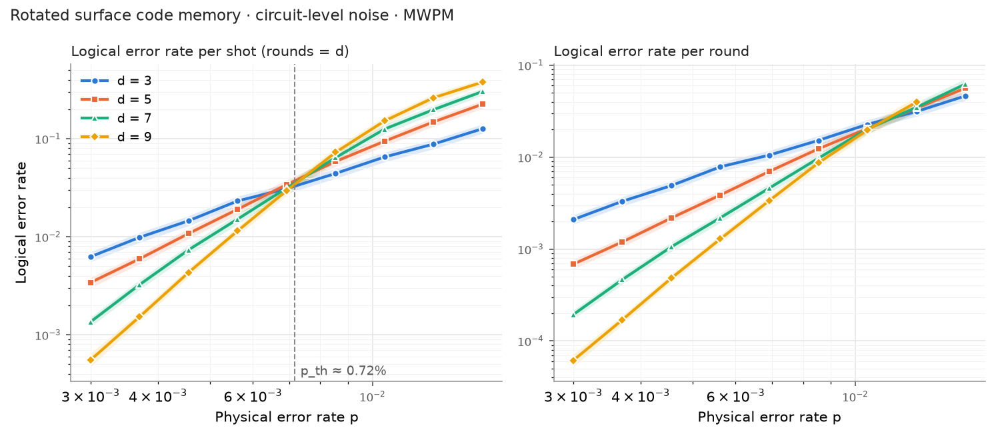
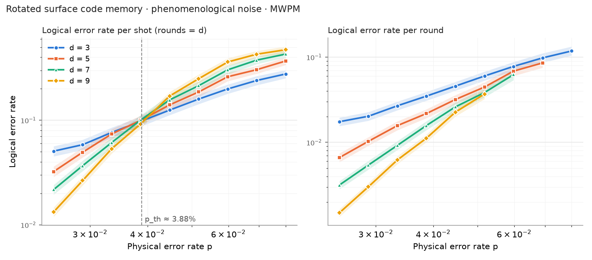

# Surface code threshold with Stim + PyMatching

Memory experiments on the rotated surface code under two noise models,
decoded with minimum-weight perfect matching (MWPM). The goal is to measure
the error threshold and the error-suppression factor Λ, and to see how much
threshold is lost going from phenomenological to circuit-level noise.



## Results

Distances d = 3, 5, 7, 9, rounds = d, MWPM decoding, 36 points per noise model.
Each point has about 1000 logical errors or more, except d = 9 at p = 0.3 % (553).

| Noise model | Threshold (mean of per-shot crossings) | Λ per round, d → d+2, at lowest p |
|---|---|---|
| circuit-level | **≈ 0.72 %** (pairwise crossings 0.65 %, 0.76 %, 0.74 %) | 3.1, 3.5, 3.2 at p = 0.3 % |
| phenomenological | **≈ 3.9 %** (crossings 3.64 %, 3.85 %, 4.16 %) | 2.6, 2.1, 2.1 at p = 2.5 % |

Observations:

- Making the syndrome-extraction circuit itself noisy costs more than a factor
  of five in threshold (3.9 % → 0.7 %): there are many more fault locations,
  and gate errors spread from measure qubits onto data qubits.
- The pairwise crossings differ by about 0.1 % (circuit-level) and 0.5 %
  (phenomenological), so each threshold is an estimate with that spread. With
  this few distances and this many samples, the runs do not establish a
  consistent drift with distance.
- At p = 0.3 % circuit-level, each step d → d + 2 suppresses the per-round
  logical error rate by more than 3× (Λ = 3.1–3.5).



## What the experiment does

1. **Circuit.** `stim.Circuit.generated("surface_code:rotated_memory_z", ...)`
   builds a distance-*d* rotated surface code, prepares logical |0⟩, runs
   *d* rounds of stabilizer measurement and measures out. Noise is added
   according to the chosen model (`qec/circuits.py`).
2. **Detector error model.** Stim enumerates every single fault in the circuit
   and records which detectors (parity checks that are deterministic without
   noise) and which logical observable it flips.
3. **Decoding.** PyMatching builds a matching graph from the detector error
   model (edge weight log((1−q)/q)) and, for each shot, finds the
   minimum-weight set of faults consistent with the observed detection events.
4. **Statistics.** A shot is a logical error when the decoder's prediction of
   the observable flip disagrees with the truth. `sinter` runs this in
   parallel until each point has enough errors.

`qec/decode.py` writes steps 2–4 out by hand; `run_threshold.py` uses
`sinter` to do the same at scale.

| Noise model | What is noisy | Expected threshold |
|---|---|---|
| `circuit` | every gate, reset, measurement and data qubits each round (uniform depolarizing, p) | ≈ 0.7–1 % |
| `phenomenological` | data qubits once per round + measurement outcomes; gates are perfect | ≈ 3–4 % |

**Two ways to count errors.** The threshold is read from the *per-shot*
logical error rate (left panels): with rounds = d, curves for different d cross
where enlarging the code stops helping. Λ is computed from the *per-round* rate
(right panels), ε = (1 − (1 − 2·P_shot)^(1/r)) / 2, which compares codes run for
different numbers of rounds fairly. Near threshold, P_shot approaches 0.5 and
this conversion becomes unreliable, so points with P_shot > 0.35 are dropped
from the per-round panels.

## Running it

```bash
pip install -r requirements.txt

python -m pytest tests                     # sanity checks (~1 min)
python single_point.py --distance 5 --p 0.005

python run_threshold.py --quick            # smoke test
python run_threshold.py                    # circuit-level sweep, d = 3, 5, 7, 9 (~1 min)
python run_threshold.py --noise phenomenological
python plot_threshold.py
python plot_threshold.py --noise phenomenological
```

Sweeps are resumable: data is appended to `data/<noise>.csv`, and rerunning
skips points that already have enough statistics.

## Layout

```
qec/circuits.py        noisy circuit construction, two noise models
qec/decode.py          hand-written DEM -> matching -> decode pipeline
single_point.py        decode one (d, p) point
run_threshold.py       sinter sweep over d and p
plot_threshold.py      plot, threshold crossing, Lambda
tests/test_sanity.py   noiseless check, circuit distance = d, etc.
```

## Limitations and next steps

- Uniform depolarizing noise; real devices have non-uniform rates, leakage and
  crosstalk.
- MWPM ignores Y-error correlations and degeneracy; correlated matching or
  BP+OSD would do better.
- Threshold is read from curve crossings at small *d*; a finite-size-scaling fit
  would be more accurate.
- Decoding here is offline. On hardware the decoder must keep up with the
  syndrome rate (~1 µs per round on superconducting qubits), which is the
  real-time decoding problem.

## Authorship

I wrote the core simulation and decoding code and ran the experiments. Tests, plotting code and README text were prepared with AI assistance.

## References

- C. Gidney, *Stim: a fast stabilizer circuit simulator*, Quantum 5, 497 (2021).
- O. Higgott & C. Gidney, *Sparse Blossom: correcting a million errors per core second with minimum-weight matching*, arXiv:2303.15933 (2023).
- A. G. Fowler et al., *Surface codes: towards practical large-scale quantum computation*, PRA 86, 032324 (2012).
